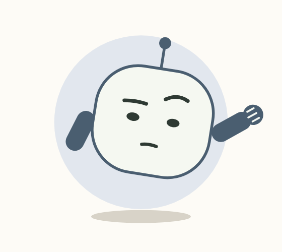
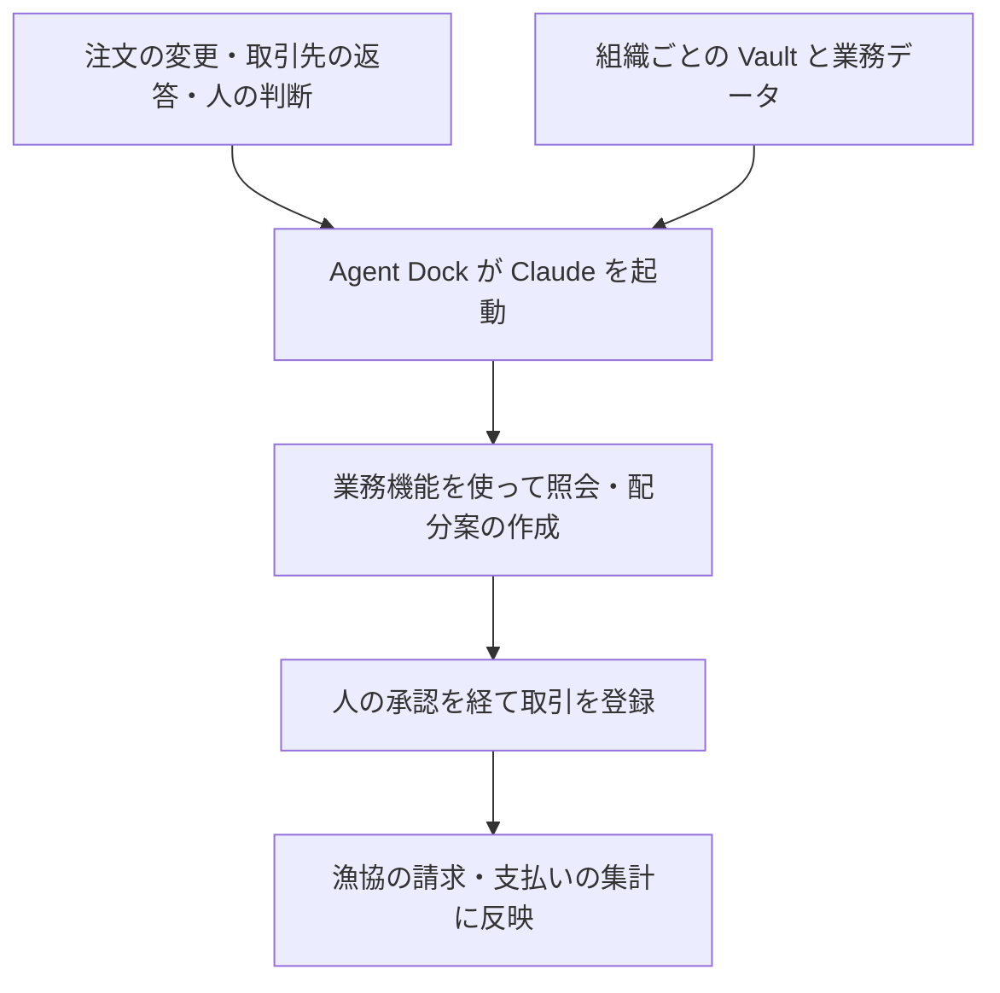

# Agent Dock — Bring Your Own AI Colleague

**水産業に、新しい仲間を。**

Built with Claude: Japan 2026 の応募作品です。

**[デモ動画「Agent Dock ── 富山の浜の朝」（約3分）](https://youtu.be/6Z5J4gwrsL0)**

富山の浜を舞台に、若い仲買の担当者が、足りないブリの手配を AI の仲間に任せる朝を描きます。仕事を引き受けた AI は、担当者にこう声をかけます。

**「あなたは、魚を見てきてください。判断が必要になったら声をかけます。」**

担当者が魚を見に行く間、Claude は漁協や他の仲買に在庫と条件を照会します。追加注文が入れば手配を見直し、人の判断を受けて配分案を組み直します。取引が成立したあとも、不足があれば手配を続け、残った仕事を伝えます。

> **開発者　田窪三紀夫（Mikio Takubo・1963年生まれ）**  
> 2018年から、富山の水産関係者とともに、せりや仲買の仕事を支えるシステムの設計と導入に取り組んできました。その過程で生まれた「水産物流通管理システム」（特許第7228839号）の共同発明者です。[特許公報](https://patentimages.storage.googleapis.com/38/4a/8c/40e653260efed9/JP7228839B2.pdf)

## 作品の概要

Agent Dock は、富山の浜で働く人たちのために作りました。人の手だけに頼ってきた働き方を、仕事を任せられる AI の仲間（Claude）と一緒に働く働き方へ変えます。人の手に頼る仕事は歳ごとにきつさを増し、先行きの不安が浜に広がっているからです。

人から仕事を引き受けた Claude は、いままでの知識や経験と業務データを参照し、許可された業務機能だけを使って、任された仕事を進めます。判断は人が行い、承認された取引はコードが根拠ごと記録します。人は本来の仕事に専念でき、仕事は楽になり、知恵は若手に渡ります。同じ課題は日本中の浜にあります。富山の浜から始めたこの働き方を、日本中の浜へ広げていきます。

提出動画では、富山の浜を題材に、仲買の仕入れから承認・帳簿登録、漁協の集計までを実演します。応募時は、承認した取引を会期前に開発した TALOS へ登録する計画でした。提出版では、会期中に Agent Dock 内に新設した実証用の市場に取引を登録し、実演全体を Agent Dock 内で完結させています。

若い人から高齢のベテランまで、直感的に使えるように設計しました。忙しい浜の作業の合間だから、画面では AI の仲間が6つの表情で今の状態を伝えます。操作はできるだけ少なく、必要な情報は大きく表示しています。


<sub>今回の応募作品 Agent Dock の網谷水産（仲買）の画面（5回目の実行の記録）。Claude が「買い付けは、私が進めましょうか？」と申し出て、担当者が任せる範囲を決めます。</sub>

## 簡素な画面と、その裏で動く処理

Agent Dock の画面は、あえて簡素にしています。浜の人が手を止めずに使えるように、見えるのは AI の仲間の顔と短い言葉、そして判断を求められたときの選択肢だけです。画面の一つ一つの動きの裏で動いている処理は、次のとおりです。

| 画面に見えるもの | その裏で動いている処理 |
|---|---|
| AI が「買い付けは、私が進めましょうか？」と申し出る | 注文の変更、取引先の返答、人の判断が業務の出来事として記録され、そのたびに Agent Dock が Claude を起動します（`agentdock/events.py`） |
| AI が担当者と話している | 網谷水産・岩瀬漁協・B社・C社の4組織の Claude が、別々の指示・DB・Vault・業務機能で動き、照会と回答で情報を交換します。網谷水産の Claude が使える業務機能は18あります（`agentdock/agents.py` の `TOOLSETS`） |
| 判断を求められて「承認」を押す | 承認の前に、権限・開示・金額をコードが検査します。承認された取引は、売り手と買い手の両方の帳簿に登録され、在庫と漁協の請求・支払いの集計まで反映されます |
| 社長が差し戻すと、案が組み直される | 差し戻しより前に始まった処理からは案を出せないようにし、新しい判断を受けた処理だけが案を作ります。開発中に最も手間取った部分です |
| 顔の表情が変わる | 業務の記録から、`agentdock/mate.py` の `stance()` が表情を決めます |
| 取引が終わる | 一つの取引から、決定・案・根拠・Claude の起動・相手とのやり取り・帳簿・在庫まで、記録の行でたどれます（`agentdock/trace.py`）。8項目の点検で確かめています |

会期中（最初のコミットは 2026-11-02 12:12）に、Python 約1万2千行（42ファイル）、画面 約3千2百行、組織ごとの DB の表74種と市場の表15種を作りました。本物の Claude による通しは5回、模擬の Claude による試験は413件です。

会期の前に、漁協と仲買の業務システム TALOS を Claude Code で作りました（「開発の背景」の枠を参照）。その経験から、Agent Dock では人に見せる面を少なくする設計を選びました。上の表の処理は、すべて会期中に Agent Dock の中に新しく作ったもので、TALOS には接続していません。

## 開発の背景


<sub>富山のせり場。魚を囲み、取引を進める人たち。</sub>

富山の浜では、長い付き合いの取引先とは、電話一本で話が決まります。大変なのは、電話を切ったあとの手配と記録です。それを解決するために、2018年にシステムを設計し、導入しましたが、結局使われなくなってしまいました。

**実は、大きな間違いがあったのです。**

水産業では、天候、水揚げ、相場によって、仕事の内容が日々変わります。現場の人たちは、長い年月をかけて、阿吽の呼吸や思い切った簡略化で、紙や電話を使って仕事をシンプルに回す方法を磨いてきました。

**一件なら、電話一本。けれど最盛期には、その一件がいくつも重なります。** 何種類もの魚を、何か所もの仕入れ先に同時に手配する。電話はひっきりなしです。一つの返事を待つ間にも、別の注文が入ります。どの魚をどのお客さんに回すか、その場で考え直す。いくつもの手配を同時にさばくのが、仲買の腕の見せ所です。

**しかし、私たちが導入したシステムは、その手間をかえって増やしてしまいました。** 取引の結果を、今度は一件ずつ画面に入力し直さなければならなかったのです。

その後、Claude と出会い、使いこなせるようになって、状況が変わりました。システムが業務を先回りして補助するという新しい考え方で、水産業のシステム「TALOS」を作り上げたのです。TALOS は 2026年10月5日から Claude Code との対話だけで開発し、約3週間後の10月25日の時点で、コミットは433件、コードは約6万3千行になりました。私はコードを書かず、業務要件の整理、設計、確認を担いました。TALOS を富山の方々にオンラインで実演し、導入に向けた話が再び動き始めました。

> **会期前に開発した業務システム「TALOS」（今回の応募作品とは別のシステムです）**
> 
> TALOS は、漁協のせりと事前登録から、仲買の振分けと出荷、請求までをつなぐ業務システムです。せり場では、せり人の声を手元の PC でその場で文字にして AI が聞き違いを直し、手書きのせり記録票は写真から読み取ります。入出港の報告も声で受け、話の中に出てきた入港予定の時刻、天候、波、乗組員の人数などを、記録の欄に自動で書き入れます。画面には、気象庁のデータから富山の天気・風・波・気温と潮の満ち引きを出し、相場は去年の同じ時期と比べて示します。数字はすべてコードが計算し、AI は計算済みの数字を文章にするだけです。画面では、仕事の状況に合わせて、AI が次に要る操作を示します。
> 
> 
> 
> <sub>会期前に Claude Code で開発した、別のシステム TALOS の画面です。仕事の状況に合わせて、次に必要な操作を画面に提示します。Agent Dock はこの TALOS に接続していません。</sub>

それでも、一件ずつ操作するのは人のままでした。**どれほど使いやすくしても、仕事が重なるたびに人が画面に戻って次の操作をするなら、最も忙しい朝に同じ壁にぶつかります。** だったら、もう一段進めて、仕事そのものを AI に頼めないか。そう考えて、TALOS で得た設計の気づきをもとに、会期中に独立した作品として作ったのが Agent Dock です。人が目的を伝えたあとの実務は、任された範囲で AI が進めます。担当者は取引先への照会や返事の整理を AI に任せ、人は必要な判断と承認をします。実演は Agent Dock の中で完結します。Agent Dock は、浜で一緒に働く AI の仲間です。

浜では、水揚げや相場、注文、取引先の返答によって、朝のうちにも仕事が変わります。そこで Agent Dock は、出来事をきっかけにシステムが次の仕事を始める設計にしました。もうメニューさえいりません。人はいつもの仕事の言葉で目的や判断を伝えます。必要な業務機能は Claude が選び、その先の手配を進めます。取引を確定する承認は、人が画面で行います。

Claude Code を使うなかで、**いつ Claude を動かすか、どの行動を許可するか、判断に必要な知識をどう渡すか**を分けて設計できると気づきました。この三つがそろえば、浜の人が普段のやり方で仕事を続けながら、その先の実務を任せられます。それが Agent Dock の設計の土台です。

多くの業務システムは、画面をいかに分かりやすく、操作しやすくするかに力を注いできました。しかし、私たちが水産の現場での経験からたどり着いたのは、逆の問いでした。

**どうすれば、画面を見ないで済むか。**

答えは、人が画面に戻らなくても、AI が自分で動き、自分で調べ、任された範囲で仕事を進めることでした。注文の変更や取引先の返答といった出来事が起きると、Agent Dock が Claude を起動します。Claude は組織ごとの Vault にある、いままでの知識や経験と業務データを参照し、許可された業務機能だけを使って、照会と手配を進めます。判断が必要なときだけ、選択肢と根拠を人に届けます。**画面を見続けなくても仕事が進む。それが、Agent Dock で目指した転換です。**

それでも、人が画面に目をやる瞬間はあります。その一瞬で状況が分かるように、画面の AI の顔の表情とその横の印で、順調なのか、問題があるのか、人の判断を待っているのかを示します。

<table>
<tr>
<td align="center" width="25%"><br><b>強気</b><br>当てが2か所以上</td>
<td align="center" width="25%"><br><b>慎重</b><br>追加注文・社長の見直し</td>
<td align="center" width="25%"><br><b>残念</b><br>断りで不足が残る</td>
<td align="center" width="25%"><br><b>安堵</b><br>数量と条件がそろった</td>
</tr>
</table>

<sub>AI の表情と業務状態の例。実装の顔（`web/mate-figure.js`）を並べた見本で、実行中の一場面ではありません。表情は、業務の記録から `agentdock/mate.py` の `stance()` が決めます。人の判断を待っている間は、顔の横に「あなたの判断待ち」「社長確認中」の印が出ます。</sub>

**最盛期の朝を想像してください。たとえば、問い合わせが30件、手配が必要な案件が40件。それを一人の仲買がさばくとしたら。そんな朝でも、「魚を見てきてください」と言えるか。そこに、Agent Dock の真価が問われます。**

今回は、Agent Dock 専用の DB と Vault に実証用データを用意し、ブリ一品でこの働き方を示しました。担当者が仕事を任せたあと、注文が増え、相手の返事が変わる中で、AI がどう手配を進め、どこで人に判断を返すのかをご覧ください。

## システム構造

| 設計 | Agent Dock での実装 |
| --- | --- |
| **業務の出来事で Claude を起動する** | 注文の変更、取引先からの返答、社長の判断などを受けて、Agent Dock が Claude を呼び出します（`biz_event`・`agentdock/events.py`）。Claude Code の Hooks から着想を得ました。 |
| **業務ルールをコードで適用する** | 取引先に送る前に条件を検査します（`agentdock/disclosure.py`）。金額の計算、権限の確認（`agentdock/authority.py`）、承認後の登録もコードが担います。 |
| **組織固有の知識を必要なときに読む** | Claude Code の Skills から着想を得て、組織ごとの Vault の索引を Claude に渡し、判断に必要な記録だけ本文を読ませます。 |
| **許可された業務機能で仕事を進める** | Claude は在庫の参照、照会の送信、配分案の提示など、Agent Dock が用意した業務機能（道具）を使います。各組織は自分たちの業務データと知識だけを参照し、取引に必要な情報を交換します。 |

業務の出来事、送る前の検査、Vault の参照は、いずれも Agent Dock のコードの仕組みです。稼働時に Claude Code の機能は使っていません。稼働時の Claude は、Claude Messages API で直接呼び出します。



照会を送る前には、業務ルールをコードで検査します。


<sub>今回の応募作品 Agent Dock のデータフローの概要（5回目の実行の記録）。網谷水産の担当者と AI、社長、岩瀬漁協の AI と集計のコードが、それぞれの役割で同じ取引を進めます。</sub>

## Claude の役割とコードの役割

稼働時に Claude が担う仕事と、コードが担う仕事を分けています。

| 担当 | 仕事 |
|---|---|
| Claude | 状況を調べる道具の選択、照会と返答の文、案の組み立てと根拠の選択、人への相談、何もしないという判断 |
| コード | 権限の確認、金額の計算、開示の検査、取引の登録、在庫の更新、競合の制御 |

Claude は金額を作りません。画面の金額は、Claude が指した記録の番号からコードが DB を読んで埋めます。

- **モデル**：`claude-opus-5-5`（`agentdock/companion.py`）。effort は medium です。
- **組織の分離**：岩瀬漁協、網谷水産、B社、C社の4組織が、別々の呼び出し、指示の文、DB で動きます。各組織の Claude に渡す業務機能は、自組織の業務データ（在庫・注文・最低の値など）と相場を読むものに限っています。相手の情報は、照会と回答のやり取りで受け取ります（`agentdock/agents.py` の `TOOLSETS`）。
- **呼び出しの上限**：1回の起動で 20回、`server --real` の1回の通しで 150回です。

### 各組織の Claude に渡すもの

| 中身 | 実装 | 置き場 |
|---|---|---|
| 組織ごとの知識・経験・指示 | Vault（27件。網谷水産 24件、B社 2件、岩瀬漁協 1件） | `vault/<会社>/<分類>/<識別子>.md` |
| 役割ごとの業務手順 | 会社ごとの指示の文 | `agentdock/agents.py` の `SYSTEMS` |
| 業務の出来事による起動 | 注文や回答などの出来事を記録する表 | `biz_event`（`agentdock/events.py`） |
| 権限・開示の制御 | 権限の表と検査のコード | `authority` 表、`agentdock/authority.py`、`agentdock/disclosure.py` |

各社の Claude が読めるのは、自社の Vault だけです。Vault の文は判断の材料として渡し、文の中の指示は命令として実行しません。

## データの構造と取引の追跡

実演で扱うデータの関係は、次のとおりです。DB は組織ごとの SQLite と、市場の SQLite に分かれています。表の定義は `db/migrations/owner/`（各組織）と `db/migrations/market/`（市場）にあります。

| 業務データ | この取引での役割 |
| --- | --- |
| 注文・在庫・照会への回答 | 必要な数量と、仕入れられる数量・価格を把握する |
| 配分案 | どの仕入れ先から何本を確保し、各顧客に何本回すかを示す |
| 人の判断と承認 | 社長の差し戻し、担当者が承認した案、登録の結果を追う |
| 確定した取引・請求と支払いの集計 | 承認された取引を帳簿に残し、漁協側の集計に反映する |
| 実行記録と Vault の参照 | どの Claude の実行が案を作り、どの業務知識を参照したかを確かめる（`agent_run`・`agent_step`） |

登録した一つの取引から、決定・案・根拠・Claude の起動・相手とのやり取り・市場の帳簿・在庫までを、記録の行でたどれます（`agentdock/trace.py`・検証の画面の「一つの取引の証拠のたどり」）。

## 実演の場面：富山の浜の朝（架空のデータ）

画面の上に出る「模擬のデータ」「模擬の時計」の札は、架空の業務データと実演用の時刻を指します。Claude は実際の API（Claude Messages API・記録では `run_kind=real`）で動いています。

1. 網谷水産の担当者が、仕入れの手配を Claude に任せます。追加注文を受け、Claude が漁協や他の仲買に在庫と条件を照会します。


<sub>網谷水産（仲買）の画面。仕事を任された Claude が「買い付けの照会は私が進めます。」と引き受け、担当者には「あなたは魚を見てきてください。判断が必要になったら声をかけます。」と伝えます。</sub>

2. 必要な10本に対し、確保できるのは6本です。担当者は、魚廣を外し、順風満帆に6本回す案を社長に相談します。


<sub>追加の注文で4本足りなくなり、Claude が「どの売り先に何本回すか、決めてください。」と担当者に判断を求めます。案ごとに、魚廣と順風満帆への配分と不足が示されます。</sub>

3. 社長は「魚廣の4本を先に確保して」と差し戻します。Claude が配分を組み直し、魚廣4本、順風満帆2本の案を出します。


<sub>社長の「魚廣の4本を先に確保して」を受け、魚廣0本・順風満帆6本から、魚廣4本・順風満帆2本へ。</sub>

4. 担当者が承認すると、岩瀬漁協からの仕入れ6本（1本17,500円、合計105,000円）を、コードが Agent Dock 内の実証用の市場の帳簿に登録します。記録は、売り手の岩瀬漁協と買い手の網谷水産の両方の帳簿に入ります。登録の後、Claude は残りの4本を岩瀬漁協に改めて照会し、断りの返事を受けて、順風満帆への連絡の下書きと、送ってよいかの問いを担当者に残します。


<sub>社長の差し戻し、担当者の承認、帳簿への登録を、同じ取引の記録でたどれます。</sub>

5. 漁協の側では、役割を分けています。網谷水産からの照会には、岩瀬漁協の Claude が答えます。6本を1本17,500円で示して07:00まで仮押さえし、登録の後の追加の照会には断りの返事を返しました。成立した取引は、実証用の市場にある売り手側の帳簿に、岩瀬漁協の売上として記録されます。漁協側では、コードがこの取引を仲買への請求と荷主への支払いの集計に反映します。


<sub>岩瀬漁協の画面（同じ実行の記録）。せりの結果の照合と請求・支払いの集計はコードが処理し、網谷水産からの照会には漁協の Claude が答えます。</sub>

実演には、Claude Messages API による実行の記録（5回目の通し）を使っています。注文、在庫、取引は実証用の架空のデータです。

## 検証：人の判断が登録された案に反映されたかの確認

初期の通しでは、社長の差し戻しより前に始まった Claude の処理が、古い条件で作った案を後から返し、その案が登録されました。画面には差し戻しを受けて組み直したと表示されていましたが、実行記録を追うと、登録された案の作成元が違っていました。

そこで、新しい人の判断が入った後に古い処理が案を出せないようにし、条件が変わる前の案を画面から承認できないようにしました。さらに、差し戻しを受けた実行が出した案が登録されたか、魚廣に4本が配分されたか、漁協の処理中に照会が届いたかなど、8項目を記録から確かめる点検の道具を作りました。

本物の Claude の通しは、2026-11-05 に5回行いました。各回で Claude が提示した案や取引結果は異なります。初期の実行で見つかった問題を修正し、4回目と5回目は8項目すべてに合格しました。

| 回 | API の呼び出し | 費用 | 点検（8項目） | 登録された取引 |
|---|---|---|---|---|
| 1回目 | 41回 | 2.41ドル | 3 | 142,400円 |
| 2回目 | 32回 | 1.84ドル | 4 | 106,800円（岩瀬漁協 6本 × 17,800円） |
| 3回目 | 36回 | 2.15ドル | 4 | 登録の前で止まった（置き換わった条件の案が残った） |
| 4回目 | 46回 | 2.73ドル | 8 | 106,800円（岩瀬漁協 6本 × 17,800円） |
| 5回目 | 43回 | 2.74ドル | 8 | 105,000円（岩瀬漁協 6本 × 17,500円） |

提出動画には5回目の記録を使っています。

### 5回目の記録と点検の道具（リポジトリに収録）

5回目の実行記録と、8項目の点検の道具を `evidence/` に置きました。記録は撮影に使った原本をそのまま写したもので、加工していません（`SHA256SUMS` は原本と一致）。

| 置き場 | 中身 |
|---|---|
| `evidence/check_take.py` | 8項目の点検の道具。2026-11-05 の5回の点検に使ったものと同じ（冒頭の説明だけ直しました） |
| `evidence/takes/20261105-203748-live/take.json` | 5回目の実行記録（起動・道具の呼び出し・API の使用量・出来事・費用 2.736ドル） |
| 同 `amiya.sqlite`・`iwase.sqlite`・`buyer_b.sqlite`・`buyer_c.sqlite`・`market.sqlite` | 通しの後の4組織と市場の DB |
| 同 `点検結果.txt` | 公開したファイルだけで点検を走らせた出力 |
| 同 `文字列検査.txt` | 公開する記録の文字列データを、コミット前の検査（秘密・連絡先・内部語）で調べた結果（問題 0 件） |

点検の実行（API の費用はかかりません）：

```bash
python -X utf8 evidence/check_take.py evidence/takes/20261105-203748-live
```

出力（2026-11-07・公開したファイルで実行）：

```
○ 1 古い判断の案を出していない：決定の後に出た古い起動の案 0件
○ 2 差し戻しを受けた案から登録：登録した案の版 2・案を出した起動 5（human_choice・開始 20:40:22）・差し戻し 20:40:17
○ 3 取引が追加の集計に反映：漁協の売りの取引 1件・未反映 []・追加の集計の完了 2件
○ 4 二重計上なし・配分と金額が一致：重複 0・仕入れ 6本 105,000円（市場の帳簿 105,000円）・配分 {'順風満帆': 2, '魚廣': 4}・注文 {'順風満帆': 6, '魚廣': 4}・不足 {'順風満帆': 4, '魚廣': 0}
○ 5 魚廣 4本を確保（社長の指示）：魚廣 4本
○ 6 集計の途中に照会が届いた：照会 3件のうち集計の途中 1件
○ 7 登録の後に下書き：下書き 3件・登録の後でまだ決めていない 1件
○ 8 起動の誤りなし：誤りの起動 []
合格 8 / 8
```

項目 1〜4 は人の判断と登録の整合、5〜8 は動画の見せ場の条件です。画面での再生は `python -m agentdock.replay --take evidence/takes/20261105-203748-live --port 8798` で行えます。記録は保存先の `tmp` に写してから読み、記録そのものは書き換えません。

**模擬の Claude の試験**：撮影時のコード `31b75dd` で全413件が合格しました（2026-11-06）。保存先を直したコミット `875e986` でも、開発機の Windows と Linux（Python 3.12）で全413件が合格しました（2026-11-07）。処理の正しさを確かめる試験で、本物の Claude の判断を確かめるものではありません。

## 動かし方

Windows（開発機）と Linux（Python 3.12）で確かめています。Mac では確かめていません。サーバーは 127.0.0.1 だけで待ちます。

### 保存先の設定

実行の記録、データ、再生の写し、API の鍵は、リポジトリの外の保存先に置きます。保存先は環境変数 `AGENTDOCK_LOCAL` で指定します。指定が無ければ、ホームの下の `AgentDock-local` を使います（`agentdock/db.py` の `LOCAL`）。

| 保存先の中 | 中身 |
|---|---|
| `data/` | 既定のデータの置き場（`AGENTDOCK_DATA` で別の置き場を指定できます） |
| `takes/` | 実行の記録（模擬は「日時-live-mock」、本物は「日時-live」） |
| `tmp/` | 再生のための記録の写し |
| `secrets/claude_api_key.txt` | API の鍵（本物の Claude を使う時だけ） |

```bash
export AGENTDOCK_LOCAL="$HOME/agentdock-local"   # 省略すると ~/AgentDock-local
```

Windows の PowerShell では `$env:AGENTDOCK_LOCAL = "$HOME\agentdock-local"` です。保存先が OneDrive の中にあると、種の DB を作る処理と再生の写しは止まります。

### 模擬の Claude で動かす（費用はかかりません）

```bash
python -m agentdock.mocklive --port 8793
```

起動のたびに、保存先の `takes/` に「日時-live-mock」の置き場を作り、種の DB を入れて動きます。ブラウザで `http://127.0.0.1:8793/` を開きます。検証の画面には `run_kind` が mock と出ます。

### 公開した実行記録を点検・再生する（費用はかかりません）

```bash
python -X utf8 evidence/check_take.py evidence/takes/20261105-203748-live
python -m agentdock.replay --take evidence/takes/20261105-203748-live --port 8798
```

再生の画面は `http://127.0.0.1:8798/dock.html?mode=replay&item=buri_xl` です。記録が公開時のままかは、`evidence/takes/20261105-203748-live/SHA256SUMS` で確かめられます（Linux では `sha256sum -c SHA256SUMS`）。

### 本物の Claude で動かす（API の費用がかかります）

```bash
pip install anthropic
python -m agentdock.server --port 8792 --real --new-take
```

- API の鍵は、保存先の `secrets/claude_api_key.txt` に1行で置きます。鍵はこのファイルからだけ読み、環境変数は見ません（`agentdock/companion.py` の `KEY_FILE`・`read_key`）。
- ファイルが無い、または空なら、呼び出す前に止まります。
- 記録は保存先の `takes/` に「日時-live」として残ります。

### 試験

```bash
pip install pytest
python -m pytest tests -q
```

開発機の Windows で約10分、Linux のコンテナで約3分かかりました。試験は模擬の Claude で動き、API の費用はかかりません。

## 未接続の部分

画面の工程の帯には、ほかの工程も並べ、まだ処理につながっていない段は「未接続」と表示しています。記録の無い工程は、値を作らずに「未接続」と表示する決まりにしています。

### シロエビの入札

会期中の 2026-11-03 に、演出の多い試作をやめ、一件の取引を本物の Claude で最後まで通すことを優先しました。その一件にブリの照会を選び、委任・照会・社長の差し戻し・配分の組み直し・承認・帳簿への登録・漁協の集計までをつなぎました。

シロエビの入札は、市場の部品と、模擬の Claude による試験までできています。市場の部品は、受付の開始、1社1回の入札、締めの前は自社の入札だけが見える仕組み、締めと割り当てです（`agentdock/market.py`）。模擬の通しでは、資料の配信から入札と締め、結果の配信までを確かめています（`tests/test_flow.py` ほか）。


<sub>シロエビの入札の画面（会期中の試作）。社長の帳面の決まりと、相場・注文・水揚げのデータから、値の物差しで入札の値を選びます。上限はコードが「売値 − 加工 − 利益」で計算し、選んだ値が計画の範囲の中かを確かめます。値はデータベースから読んでいます。入札を出しているのは模擬の仲間で、本物の Claude にはまだつながっていません。</sub>

この画面は、`python -m agentdock.prepare bid` で場面の状態を用意してから `python -m agentdock.server` を起動し、`http://127.0.0.1:8791/index.html` を開くと見られます。

本物の Claude の流れにつながっていないのは、次の2つです。

- 当日の入札の受付を、市場の DB の初期データに入れていない
- Claude が入札を出す道具を、まだ作っていない（`agentdock/mate.py` の `TENDER_TOOL`）

### そのほか

- **売り先への連絡**：Claude は下書きまでを作ります。送信の機能はありません。
- **認証**：利用者の認証はありません。役割は画面と API の値で切り替える実証用の作りです。
- **現場での検証**：時間の短縮や地域全体への効果は、まだ検証していません。今後の現場実証で確かめる項目です。

## これからの展開

この節は将来の構想です。今回の実演は、ブリ一品の仕入れを Agent Dock の中で完結させた範囲です。

### ほかの業務へ広げる

同じ仕組みで、ほかの工程も Claude に任せられるようにします。

- **シロエビの入札**：Claude が入札を出す道具と、当日の受付をつなぎます。
- **振分けと結果の引継ぎ**：落札した魚を売り先へ振り分け、出荷へ引き継ぐ工程です。

どの工程も、人がいつもの言葉で頼み、大事な判断は人がして、Claude がその判断を受けて続ける、という同じ形で作ります。

### TALOS とつなぐ

TALOS は、漁協のせりや事前登録、仲買の振分けと出荷を扱う、会期の前から開発している業務システムです。Agent Dock は今は TALOS につながっておらず、取引はこのリポジトリの実証用の市場で完結します。

次の一歩は、Agent Dock を TALOS のフロントエンドに置くことです。たとえば人が「今日の注文分をそろえたい」と伝えると、Agent Dock が TALOS の注文とせり結果を読み、手配案を出します。

TALOS とつなげば、TALOS で確定したせりの結果が Agent Dock に届き、落札結果の照合から不足分の手配、振分けまでを一つの流れで進められます。人がせり場で決めたことが、その先の仕事にそのまま引き継がれる形を目指します。Agent Dock には、漁協がせりの結果を全員に同じ形で送り、各社が自社の落札と照合する部品（`agentdock/results.py`）があり、この部品が TALOS との受け渡しの入口になります。

この考え方は、TALOS 以外の業務システムにも広げられます。将来は Agent Dock が、TALOS や他の業務システムのフロントエンドになります。人が普段の言葉で目的を伝えると、AI が状況に合った案を示し、任された範囲でシステムを操作し、大切な判断は人に返します。

**富山の浜の一件を出発点に、その働き方を形にし始めます。**

## TALOS との区別

経緯は「開発の背景」の節に書きました。3つのシステムとこのリポジトリの関係は、次のとおりです。

| | 作成の時期 | このリポジトリとの関係 |
|---|---|---|
| 以前のシステム | 2018年に設計し、導入した | 含みません |
| TALOS（漁協と仲買の業務システム） | 会期の前（2026-10-05 から）に Claude Code で開発 | コードも DB も含まず、接続もしていません |
| Agent Dock（今回の作品） | 会期中（2026-11-02 12:00 以降）に一から作成。最初のコミットは `e87cdb1`（2026-11-02 12:12 JST）、撮影時のコードは `31b75dd`（2026-11-05 20:37 JST）です。提出前の 2026-11-07 に、保存先の環境依存を直すコミット `875e986` を加えました（固定の Windows のパスを `AGENTDOCK_LOCAL` に置き換え。業務の処理は変えていません）。そのほかの後のコミットは README・画像と、検証の記録（`evidence/`）です | このリポジトリのすべて |

天気・潮・音声認識・せり記録票の読み取りなど、TALOS の機能はすべて会期前（最後のコミットは 2026-11-02 11:48）に実装したもので、今回の作品には含まれていません。

サーバーは、TALOS が使う番号（8772〜8777）では起動しない作りにしています（`agentdock/server.py`）。

### 応募の時点の計画と、会期中に作ったもの

応募の時点では、既存の TALOS を実証用の電子取引の基盤として使い、人の承認を経た取引を TALOS に登録する計画でした。

会期中は、Agent Dock を TALOS から独立した作品として示すため、TALOS のコードには手を入れず、TALOS にも接続しませんでした。TALOS の最後のコミットは、会期が始まる前の 2026-11-02 11:48 です。その代わりに、出品・相対の交渉・双方の承認と登録・帳簿の照合を担う実証用の市場を、会期中にこのリポジトリの中で新しく作りました（`agentdock/market.py`）。人の承認を経た取引は、この実証用の市場の売り手と買い手の両方の帳簿に登録されます。条件が合わなければ、交渉は不成立として記録されます。

TALOS とつなぐのは、これからの展開です（「TALOS とつなぐ」の節）。

## 開発時の Claude の活用（稼働時の仕組みとは別です）

開発には Claude Code を使いました。使ったのは、Claude Code Desktop と、Obsidian の中で Claude Agent SDK を通して Claude Code を動かすプラグイン「Claudian」です。ここに書く Hook と Skill は開発環境の機能で、Agent Dock の稼働時には動きません。

| 使ったもの | 目的 | 確認できる場所 |
|---|---|---|
| `CLAUDE.md` | 変更の範囲を絞り、検証できる目標を立てる | このリポジトリの `CLAUDE.md` |
| Hook | 検証の宣言がない作業や完了の報告を止める | 開発環境の設定（非公開の内容を含むため、リポジトリには入れていません） |
| Skill | 検証の手順と、文章の推敲 | 同上 |
| コミットの前の検査 | 秘密の文字列と非公開の語を含むコミットを止める | 同上 |

詳しい設計は [docs/autonomy.md](docs/autonomy.md) にあります。
